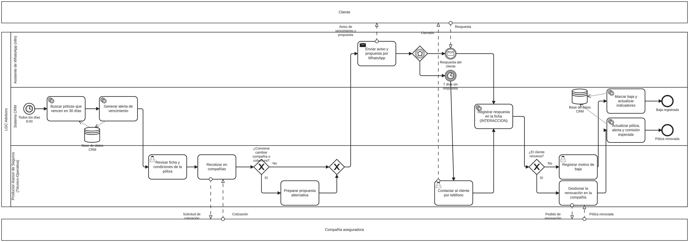

# Proceso de renovación de pólizas — BPMN 2.0 (Entrega 4)

- **Archivo editable:** [`renovacion_polizas.bpmn`](renovacion_polizas.bpmn). Se abre en [bpmn.io](https://demo.bpmn.io) o Camunda Modeler.
- **Participantes:** Cliente y Compañía aseguradora (pools externos); LGC Advisors con tres carriles: Asistente de WhatsApp (n8n), Sistema CRM y Productor Asesor de Seguros.
- **Inicio:** evento temporizador diario (8:00). **Fin:** póliza renovada o baja registrada.
- **Decisiones:** ¿conviene cambiar compañía o cobertura?; respuesta del cliente o 7 días sin respuesta (compuerta basada en eventos); ¿el cliente renueva?
- **Datos:** almacén *Base de datos CRM* (entidades POLIZA, ALERTA_VENCIMIENTO, INTERACCION y COMISION del diccionario de datos).
