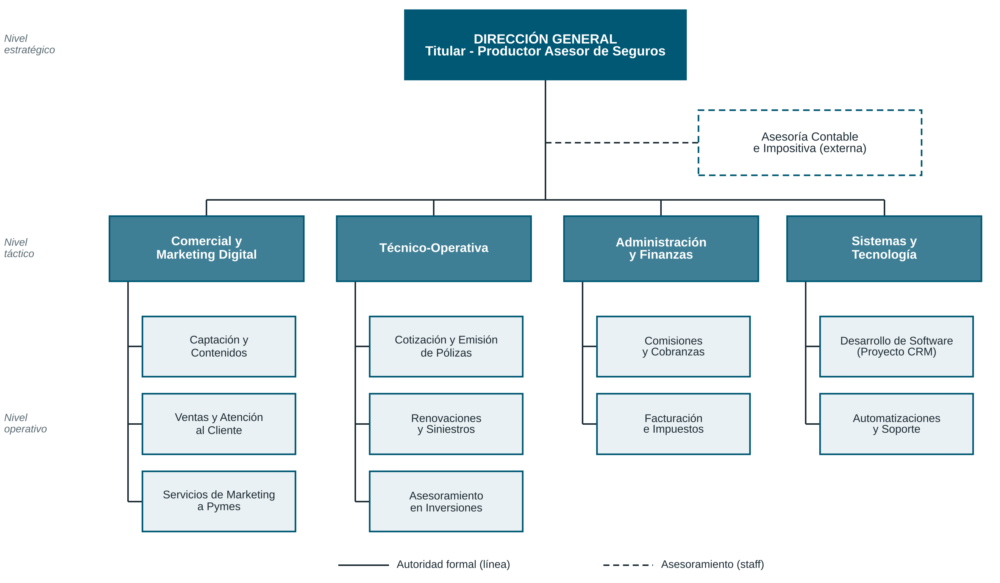

# Organigrama de LGC Advisors (Entrega 3)

- **Tipo:** piramidal vertical, departamentalización funcional, tres niveles (estratégico, táctico, operativo).
- **Línea continua:** autoridad formal. **Línea de trazos:** staff (Asesoría Contable e Impositiva, externa).
- Las áreas del nivel táctico coinciden con los subsistemas identificados en la Entrega 1.
- El proyecto CRM está a cargo de la sección *Desarrollo de Software* (Sistemas y Tecnología), pero sus usuarios están en todas las áreas.
